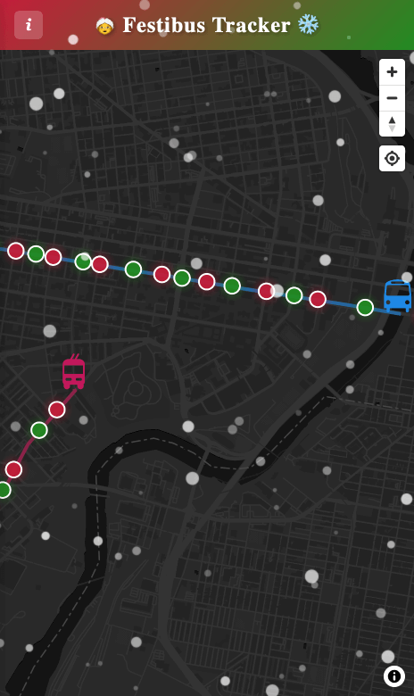

# SEPTA Holiday Bus Tracker

Track SEPTA's decorated holiday buses in real-time across Philadelphia. See where they are now and where they're heading next.



## Repository Structure

```
├── backend/          # Fastify API server
│   ├── bin/          # Scripts (GTFS download)
│   ├── config/       # The decorated fleet (fleet.json)
│   ├── data/gtfs/    # Downloaded GTFS schedule data
│   ├── lib/          # Feed polling, schedule loading and route prediction
│   └── test/         # Unit tests
├── frontend/         # React + Vite web app with MapLibre GL
└── .tool-versions    # asdf version management
```

## Prerequisites

- [asdf](https://asdf-vm.com/) with nodejs plugin

## Quickstart

```bash
# Install Node.js via asdf
asdf install

# Download GTFS schedule data
cd backend
npm install
node bin/download-gtfs.js

# Start backend (in one terminal)
npm run dev

# Start frontend (in another terminal)
cd frontend
npm install
npm run dev
```

Open <http://localhost:5173> to view the map.

## Test Mode

To view test buses instead of holiday buses (useful for development when holiday buses aren't running), add `?test=true` to the URL:

<http://localhost:5173/?test=true>

## The Fleet

The decorated vehicles are listed in one place, `backend/config/fleet.json`. The backend tracks them and serves the same list to the frontend for the sidebar.

```json
{
  "notice": null,
  "vehicles": [
    { "id": "3019", "type": "bus", "district": "Callowhill", "name": "Santa Paws", "color": "#1e88e5" },
    { "id": "9027", "district": "Elmwood" }
  ]
}
```

- `id` is the SEPTA vehicle number and is the only required field.
- `type` is `bus` or `trolley`. If left out, numbers in the 9000s are treated as trolleys.
- `name` is the decoration theme. Leave it out until it's announced.
- `color` is the marker color. If left out, one is assigned.

Set the `FLEET_FILE` environment variable to load the fleet from somewhere else, such as a mounted ConfigMap. Edits to the file are picked up within a few seconds, with no restart. If an edit is invalid, the last good fleet stays in effect and the error is logged.

### Coming soon mode

While `vehicles` is empty, the site shows a festive "coming soon" notice over the map instead of tracking anything. Add vehicles to go live; empty the list to go back.

### Event notice

To show a banner on the map (for example on a night when the whole fleet is on display), set `notice`. The dates are optional; without them the notice shows until you remove it.

```json
"notice": {
  "text": "Tonight: see all the Festibuses at LOVE Park, 5 to 8 PM",
  "startsAt": "2026-12-05T12:00:00-05:00",
  "endsAt": "2026-12-05T21:00:00-05:00"
}
```

## What the Map Shows

Each vehicle in the fleet is in one of four states:

| State | Meaning | On the map |
| --- | --- | --- |
| In service | On a trip and reporting its position | Marker, route line and stops for the next 30 minutes |
| Parked | Reporting its position but not on a trip: at a depot, on display, or between runs | Marker only, slightly faded |
| Last seen | Stopped reporting, or its position is more than 5 minutes old | Faded marker where it last reported, for up to 18 hours |
| Not out | Hasn't reported since the server started | Listed in the sidebar only |

As a vehicle nears the end of a trip, the start of the next trip it's scheduled to run is drawn as a dashed line.

The last-seen positions are held in memory, so they're forgotten when the server restarts.

## Schedule Data

A copy of SEPTA's schedule is baked into the Docker image when it's built. The server checks for a newer schedule a minute after starting and every six hours after that, and loads it without a restart.

`GET /health` reports how old the live vehicle data is and which schedule is loaded. It returns 200 whenever the server is up, because restarting can't fix a SEPTA outage.

## Tests

```bash
cd backend && npm test          # unit tests (time, fleet, routing, vehicle status)
cd frontend && npm run lint
```

Both run in CI before the image is built.
